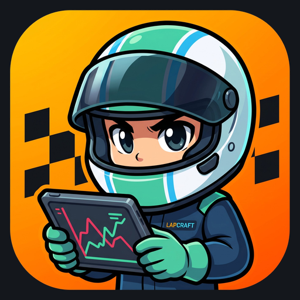
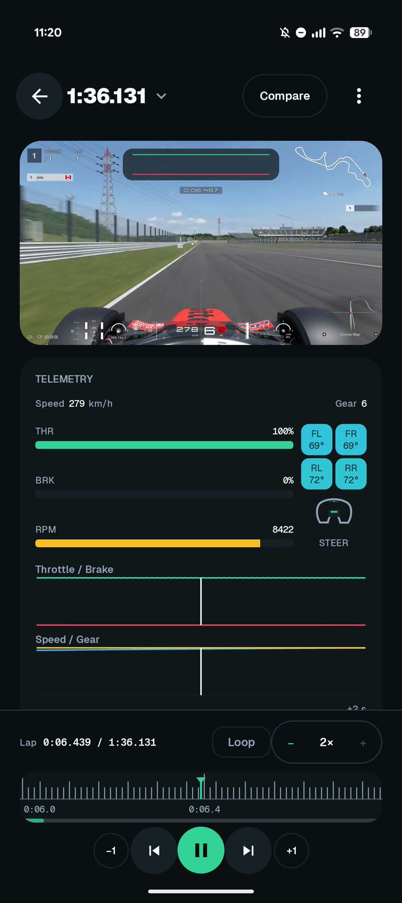
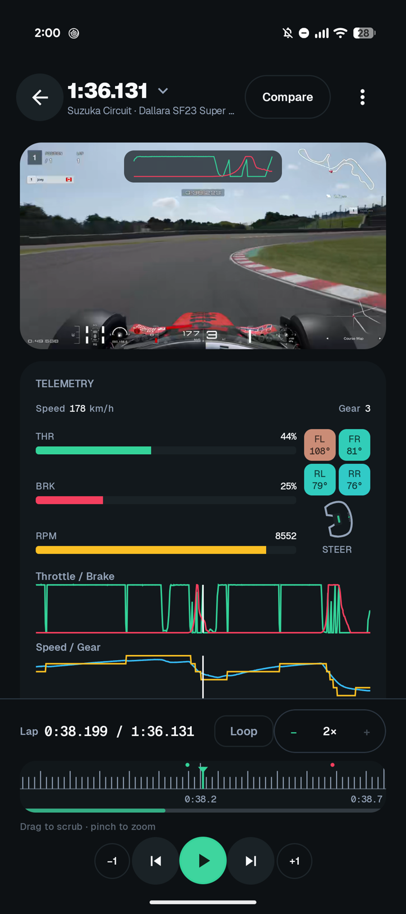
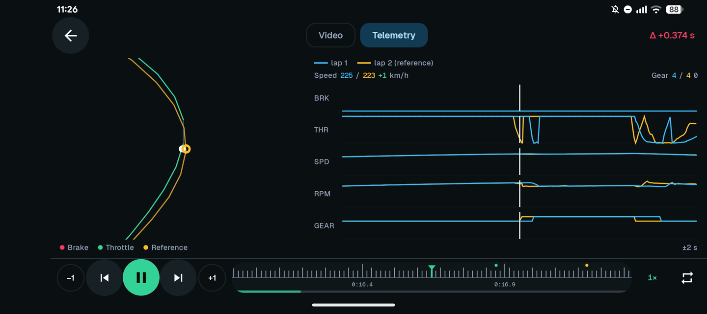

<p align="center">
  
</p>

<h1 align="center">LapCraft</h1>

<p align="center">
  GT7 telemetry at 60 Hz, synced to the replay from your PS5, on one cursor.
</p>

<p align="center">
  <a href="https://lapcraft.jlai.ca">Website</a> &middot;
  <a href="https://github.com/jlai403/lapcraft">Source on GitHub</a> &middot;
  <a href="LICENSE">GPL-3.0</a>
</p>

<p align="center">
  
  
</p>

## What it is

LapCraft records one lap of Gran Turismo 7 telemetry and syncs it to the single-lap replay exported from the PS5. The video, the charts, and the track map move on the same clock, so you can see what the car and the driver did at the exact frame you are looking at. It is free, open source, and runs entirely on the phone.

It does not capture video or audio. GT7's own replay is the video source.

## Screenshots

<p align="center">
  
  
  
</p>

## Demo

https://github.com/user-attachments/assets/8b36ff58-3bde-449b-8a53-9378593979ac

A 26 second cut of the lap workflow, without voice. The portrait version for the Play Store is [master-vertical.mp4](tools/demo/master-vertical.mp4). Both cuts are built by the kit in [tools/demo](tools/demo/README.md).

## Install

Requires Android 10 or later.

- **Preview build.** Every push to `main` replaces the `preview-latest` release with `LapCraft-preview.apk`. Install from [Releases](https://github.com/jlai403/lapcraft/releases), or with [Obtainium](https://github.com/ImranR98/Obtainium) using the direct APK link `https://github.com/jlai403/lapcraft/releases/download/preview-latest/LapCraft-preview.apk`. A repo-level Obtainium entry also picks up the per-build tags, and a tag that gets promoted carries the stable APK beside its preview, so the rolling release is the source that keeps working. Preview builds check the `preview-latest` channel.
- **Stable build.** Tagged releases carry `LapCraft-<tag>.apk`. Install from [Releases](https://github.com/jlai403/lapcraft/releases/latest), or point Obtainium at the direct APK link `https://github.com/jlai403/lapcraft/releases/latest/download/LapCraft.apk`.
- **Sideloading.** Android shows its unknown-source prompt and Play Protect scans the APK. That is the browser and the system, not LapCraft. The app never downloads or installs an update itself; it opens the release page in the browser. Preview and stable are separate packages, so both can be installed side by side.

Every release APK is signed with the project's release key, never the Android debug key. The certificate fingerprint is recorded in [AGENTS.md](AGENTS.md). Checks are skipped when the app was installed by F-Droid or Play.

## How it works

0. Optionally add your GT profile in **Settings, Driver profile**. It becomes the default driver for new laps and the name and flag appear above the lap list.
1. **LapCraft, Record**: connect to GT7 and drive.
2. Tap **Capture this lap** after crossing the start line. The app saves exactly one lap at the next crossing.
3. In GT7, record the single-lap replay with the HUD on and the race camera. Use the PS5 Create menu and keep a few seconds of lead-in.
4. Media Gallery, **Upload to PlayStation App**; in the PS App, **Download** or **Share** to LapCraft. The lap screen's replay source button opens Files or the PlayStation App (or its store listing).
5. Open the lap, **Add replay**, **Files**. The playhead starts at the clip's end with a suggested lap start. Drag the timeline or the frame ruler, or frame-step back to the line, then **Use this frame**.
6. Check the finish frame, preview, save, and review. The trimmed clip is one lap; the imported original is deleted.

The phone records no video and no audio. Telemetry uses UDP 33739/33740; the only other network calls are update checks and the optional profile lookup.

## What you get

- **Lap feed.** Flat list, no card boxes, lap time as the hero number, per-track fastest lap marker or delta, the lap's driver with flag, swipe to edit or delete, hairline dividers, pull to refresh. Filters for event kind, event, and track.
- **Edit sheet.** Track name (with candidates for unknown laps), driver, and replay actions (Add, Replace, Resume sync).
- **Driver book.** New captures default to the owner; the lap screen's Driver card selects a cached driver, adds one by PSN (with manual name and country fallback), or clears it.
- **Replay sync.** End-of-clip start with a suggested anchor, timeline scrubber, frame ruler (6 dp per frame, optional haptics), play and plus or minus 10 s, plus or minus 1 frame, track percent, preview, hard block for short clips. Lossless MP4 trim with keyframe alignment and stored lead-in.
- **Lap player.** Media3 video with the same playback controls, a lap-only slider and frame ruler, brake, throttle, speed, RPM, and gear charts on a track progress axis, plus a track map.
- **Compare, landscape.** Two same-track laps under one playback control, split into a Video tab (both replays, HUDs, and a pedal, tyre, and steering strip) and a Telemetry tab (shared track map plus brake, throttle, speed, RPM, and gear charts). The reference lap follows the primary by track progress, frame exact and muted. The library offers a compare mode and the lap player's Compare pill picks the reference.
- **Compact playback footer.** One row in compare, and the taller time, ruler, and transport layout in the single-lap player.
- **CSV export and MP4 sharing.**
- **Library backup.** Multi-select lap export to a zip and merge-only import, from Settings or the empty library. The empty library also offers Import a backup.

## Your data

Local-first. No accounts or cloud calls. Anonymous usage sharing is opt-in and off by default (PostHog, US region); the app sends no telemetry unless the user turns it on. The optional profile lookup sends only the PSN ID to gt-gridstats.com (plus a Bearer API key you paste in Settings when you want DR, SR, and car names); manual driver entry stays offline. Car names come from a bundled catalogue generated from GT GridStats. Optional event tags use the same key plus the public GT championship schedule.

Settings, Library exports the laps you select to one `.zip` (`lapcraft-library-<date>.zip`). Each lap is a directory inside the archive holding `lap.json`, its `.gt7lap` telemetry, and any clip or pending source the lap references, so the file is inspectable with any zip tool. Clips are passed through uncompressed; telemetry and JSON are deflated.

Import merges: ids that already exist are skipped, so importing the same file twice is safe. A lap whose clip is missing still imports, without a replay. The archive includes cached profiles for the exported laps' drivers. Settings and the owner stay on this device.

## Limitations

- Wrong-lap detection is visual: a single anchor cannot prove which lap a clip contains. A clip shorter than the lap is blocked.
- PS App clips are limited to under 3 minutes and 1080p or lower; long laps need USB or a broadcast MP4.
- The replay must be recorded with enough lead-in that the trimmed start is inside the clip.
- Car names resolve through the bundled catalogue, falling back to `Car #<code>`.

## Development

Requires JDK 17+ and the Android SDK (compileSdk 36).

```bash
export ANDROID_HOME=/opt/android-sdk
cd android
./gradlew :core:test :app:testDebugUnitTest :app:lintDebug :app:assembleDebug
adb install -r app/build/outputs/apk/debug/app-debug.apk
```

Tests:

```bash
cd android
./gradlew :core:test :app:testDebugUnitTest
```

- `:core` holds protocol decrypt and decode, lap detection, capture coordination, track signatures, clip sync and trim planning, track progress, codecs, lap summaries, CSV, remux planning, and the lap clock.
- `:app` (JVM) holds the lap saver, replay copy, decode-failure text, telemetry notification text, settings, frame-ruler stepping, and Compose UI for Record, Library, lap player, and import sync.
- Not covered by JVM tests: real `MediaExtractor`/`MediaMuxer` trim output, real GT7 packets, actual video decode. Those stay device checks.

Further reading: [AGENTS.md](AGENTS.md) for conventions and the release process, [docs/specs/2026-11-10-lapcraft.md](docs/specs/2026-11-10-lapcraft.md) for the product and technical spec, [DESIGN.md](DESIGN.md) for the design system, [GLOSSARY.md](GLOSSARY.md) for terminology, and [tools/demo/README.md](tools/demo/README.md) for the demo video kit.

## Contributing

LapCraft is licensed under GPLv3. Contributions are accepted under the project's contributor CLA. See [LICENSE](LICENSE) and [THIRD_PARTY_NOTICES.md](THIRD_PARTY_NOTICES.md).

## Acknowledgements

## Acknowledgements

GT GridStats provides the optional driver profile and car catalogue data. See `DriverProfileLinks` in the app for the project link.
